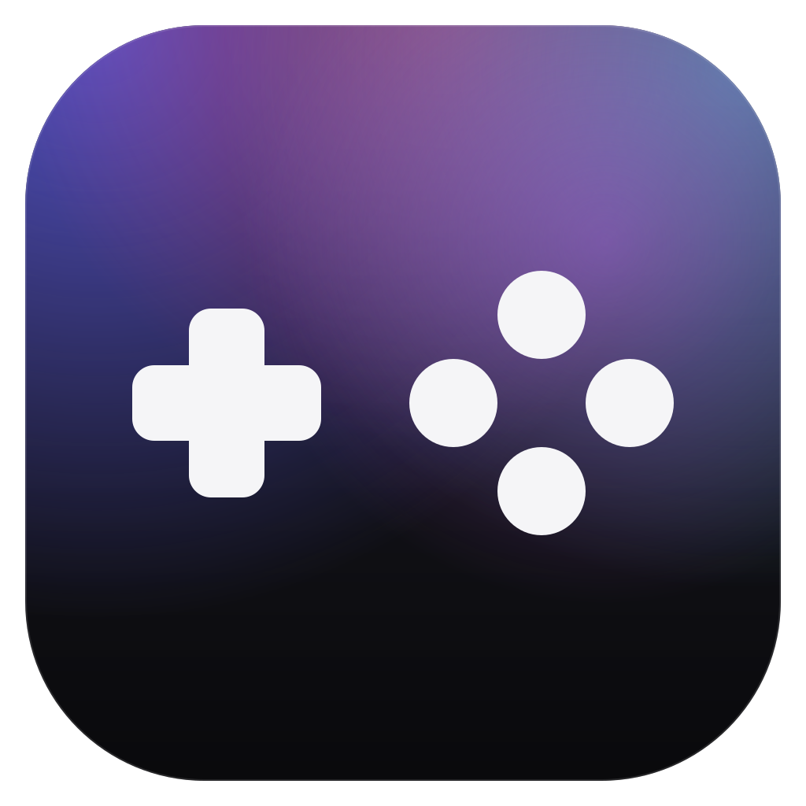
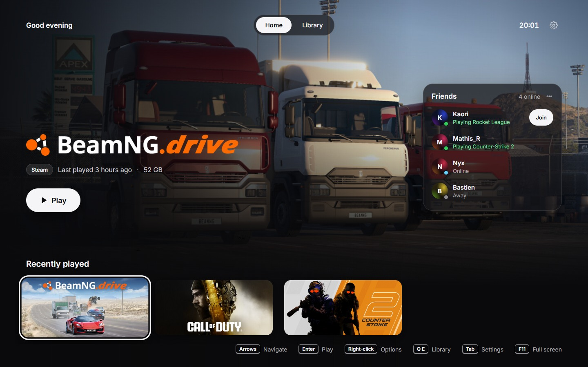
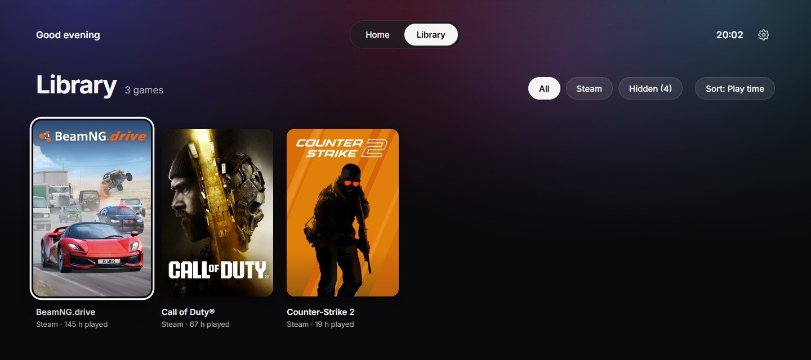

<div align="center">



# Lounge

**Your PC games, on the couch.**

A minimal, controller-first launcher that turns your Windows library into a console-style home screen, then gets out of the way the moment you hit Play.


**[⬇ Download for Windows](https://github.com/tguillain/lounge/releases/latest)**

</div>

<p align="center">
  
</p>

---

Steam's Big Picture mode is heavy. Store launchers are noisy. Lounge is neither: one calm screen with your games, your friends and a big **Play** button, designed for a DualSense in your hands and the PC across the room.

## Highlights

### 🎮 Built for the controller
- Full navigation with a **PS5 DualSense**, an Xbox pad, or keyboard and mouse. Switch any time.
- On-screen hints follow what you're holding: ✕ ○ △ for PlayStation, A B Y for Xbox, keys for the keyboard.
- Haptic tick as you move between games, and soft, low navigation sounds you can turn off.
- The DualSense **light bar takes the colors of the selected game**, and its battery level sits next to the clock.

### 🏠 A home screen worth landing on
- Full-bleed hero art and the game's official logo, straight from Steam's local cache.
- A *Recently played* shelf sized to your screen, with whole cards centered and the neighbours peeking out evenly.
- **Steam friends** online right now, with what they're playing and a one-press **Join**.
- Steam installs and updates show their progress live on the game's card.

### 📚 A real library
- Every installed game as a grid of covers.
- Filter by store (Steam, Epic Games) and **sort by play time**, recently played, name or size.
- The line under each cover follows the sort: *145 h played*, *2 days ago*, *52 GB*.
- **Search** with an on-screen keyboard: it ignores accents and punctuation and understands initials, so *cs2* finds Counter-Strike 2.
- Hide the clutter (tools, demos, benchmarks) from Home without losing it.

### 🗂️ A page for every game
- Press **down** on Home, or **✕** on a game in the Library, to open its page: the art, the logo, its genres and a short description from the Steam store, the developer and the release date.
- Your play time, when you last played, the friends playing it right now, and how much space it takes and where.
- **Play**, your achievements, the game's folder and more options, one button each.
- Your Steam screenshots of the game, or the store's when you haven't taken any, full screen with ✕.

### 🏆 Steam achievements
- The Home screen shows how many achievements of the selected game you've unlocked.
- The game's Options menu opens the full list: latest unlocks first, then locked ones from most to least common, with unlock dates, the share of players who have each one, and rare ones in gold.
- Hidden achievements stay masked until you choose to reveal them.

<p align="center">
  
</p>

### ⏯️ A Quick Menu in game
- Press the **PS button** mid-game and a floating panel slides in over the game: *Back to Lounge* and *Quit game*, sound on or off, the sound output, a volume slider, and *Sleep*, *Restart* and *Shut down*. ○ takes you straight back to the game.
- It shows how long you've been playing, this session and in total, and your achievement progress: what you unlocked this session, or the most common ones still locked.
- The gear opens Lounge's Settings.
- No controller in hand? Pick a **keyboard shortcut** in Settings, like F10 or Ctrl + Shift + Q. Lounge only claims it while a game is running.
- Lounge tracks the session on its own, for Steam and Epic games alike: it knows when a game starts, brings it back to the front, and returns to Home when you quit.

### 🔌 Control Center
- Press the **PS button** on Home, or click the power icon, to switch the **sound output** (TV, speakers, headset, the controller's jack), put the PC to **sleep**, **restart** it, **shut it down** or quit Lounge.
- Restarting, shutting down and quitting ask first. Switching the output plays a soft chime on the new one.

### 🪶 Light on purpose
- The main window is **destroyed** while you play, not just hidden. What's left is a tray icon and a tiny watcher.
- Native Rust core on the system WebView2. No bundled Chromium, a ~2.5 MB installer.
- Every background effect is a static gradient. No animated wallpapers eating your GPU.

### ⚙️ Feels like a console
- **Start with Windows** and **open in full screen**, both opt-in from Settings.
- Press Options (≡), Tab, or the gear icon to open Settings.
- Lounge **updates itself**: a green dot on the gear icon means a new version is ready.

## Controls

| | DualSense | Xbox | Keyboard and mouse |
|---|---|---|---|
| Move | D-pad / left stick | D-pad / left stick | Arrow keys |
| Play / select | ✕ | A | Enter / click |
| Open a game's page | ↓ on Home, ✕ in the Library | ↓ on Home, A in the Library | ↓ on Home, Enter in the Library |
| Back | ○ | B | Esc |
| Game options and achievements | △ | Y | Right-click |
| Search the library | □ | X | / or Ctrl+F |
| Home ⇄ Library | L1 / R1 | LB / RB | Q / E |
| Settings | Options | Menu | Tab |
| Control Center (on Home) | PS | | Power icon |
| Quick Menu (in game) | PS | | Your shortcut, set in Settings |
| Full screen | | | F11 |

## Stores

| Store | Library | Artwork | Play time | Launch | Session tracking |
|---|---|---|---|---|---|
| Steam | ✅ | ✅ local cache, CDN fallback | ✅ | ✅ | ✅ |
| Epic Games | ✅ | ✅ launcher catalog | ✅ counted by Lounge | ✅ | ✅ |
| Rockstar Games | 🔜 | | | | |

Lounge reads what your launchers already keep on disk: Steam library folders, app manifests, the artwork cache and your local play time, and the Epic Games Launcher's install records (old and new format) and catalog. No sign-in, no scraping.

Epic doesn't keep play time on your PC, so Lounge counts it itself: every Epic session it sees adds up, from the first one on.

## Privacy

- Everything about your library is read **locally**.
- A game's page asks the Steam store for its public description, genres and screenshots, without a key or your account, and keeps the answer on disk for a week.
- Steam friends and the full achievement lists are optional. They need a free Steam Web API key, which Lounge stores in **Windows Credential Manager**, never in a file or in this repo. Without it, achievements fall back to what Steam keeps on your PC.
- Lounge only opens `steam://` and `com.epicgames.launcher://` launch links. Anything else is refused.

## Install

1. Download `Lounge_x.y.z_x64-setup.exe` from the [latest release](https://github.com/tguillain/lounge/releases/latest).
2. Run it. It installs for your user account only, no admin rights needed.
3. Open Lounge from the Start menu, then turn on **Start with Windows** in Settings if you want the full console feel.

From 0.1.3 on, Lounge keeps itself up to date: a green dot on the Settings icon means a new version is ready, and **Settings → About** installs it in a few seconds. Updates are signed, and Lounge refuses any installer that isn't.

> The installer isn't code-signed, so Windows SmartScreen may warn about an unknown publisher. Choose **More info → Run anyway**.

## Build from source

**You'll need** Windows 10 or 11, [Node.js](https://nodejs.org/) 20+, the [Rust toolchain](https://rustup.rs/), and the [Tauri prerequisites](https://v2.tauri.app/start/prerequisites/) (the Microsoft C++ Build Tools and WebView2, which Windows 11 already has).

```bash
cd app
npm install
```

Run it in development, with hot reload:

```bash
npm run tauri dev
```

Build the release app and its installer, in `app/src-tauri/target/release/bundle/nsis/`:

```bash
npm run tauri build
```

Maintainers publish with `npm run release` instead. It builds the same installer, signs it with the update key (kept outside the repo, in `~/.tauri/lounge.key`), and writes the `latest.json` that installed copies read to find updates. Attach both files to the GitHub release.

Run the tests:

```bash
npm test
```

```bash
cd src-tauri && cargo test
```

## How it's built

```
app/
├─ src/                    SvelteKit front end (Svelte 5, TypeScript)
│  ├─ routes/+page.svelte    Home and Library
│  ├─ routes/quick-menu/     The in-game overlay
│  └─ lib/                   Components, gamepad input, library logic
└─ src-tauri/src/          Rust core
   ├─ steam.rs, epic.rs      Store detection (with a small VDF parser)
   ├─ watcher.rs, session.rs Game sessions for Steam and Epic: start, focus, quit
   ├─ playtime.rs            Play time Lounge counts itself, for Epic games
   ├─ process.rs             Running games, even ones started as administrator
   ├─ pad.rs, quick_menu.rs  DualSense over HID and the PS button overlay
   ├─ shortcut.rs            The Quick Menu keyboard shortcut, held only in game
   ├─ dualsense_output.rs    Rumble and light bar reports for the DualSense
   ├─ lightbar.rs            The light bar color of each game
   ├─ friends.rs             Steam friends via the Web API
   ├─ achievements.rs        Steam achievements, from the Web API or Steam's cache
   ├─ details.rs             A game's store page, screenshots and install folder
   ├─ audio.rs, power.rs     Sound output, volume and mute; sleep, restart, shut down
   ├─ update.rs              Signed self-updates
   └─ window.rs, autostart.rs Window lifecycle and Start with Windows
```

- **Rust** does the heavy lifting: scanning stores, trimming and caching logos, reading the DualSense over HID, tracking the running game, and managing the window.
- **Svelte** draws the interface and reads controllers through the Gamepad API while Lounge is on screen.
- They talk through a small set of Tauri commands and events.

## Roadmap

- [x] Session tracking, *Now playing*, artwork and play time for Epic games
- [ ] Rockstar Games Launcher support
- [x] Single instance: reopening Lounge brings back the running one
- [x] Subtle navigation sounds
- [x] Steam achievements
- [x] Control Center: sleep, restart, shut down and sound output
- [x] Session time and achievements of the running game in the Quick Menu
- [x] A keyboard shortcut for the Quick Menu
- [x] A page for every game, with its screenshots
- [ ] GOG, EA, Ubisoft and Battle.net libraries, and adding any game by hand

## License

Lounge is released under the [MIT License](LICENSE).

Game names, logos and artwork shown in Lounge and in these screenshots belong to their respective owners. Lounge only displays what your own launchers have already downloaded.

---

<div align="center">
<sub>Made for playing PC games from the couch. Built with Tauri, Rust and Svelte.</sub>
</div>
